# CivicShield — Water Resilience Security Demo

CivicShield is a demo security-operations app for a small community water
utility: asset inventory, baseline assessments against 20 built-in rules,
CVE findings with NVD advisories, AI-assisted remediation plans
(Meta Muse Spark, with an offline template fallback), incident workflow,
and backup/recovery readiness. All records are local; nothing touches
production systems.

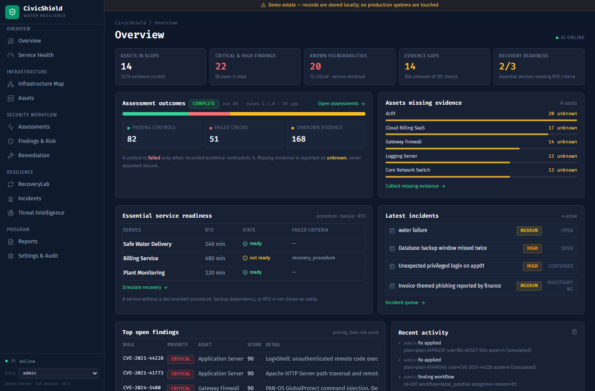

## Screens

**Overview** — assets in scope, critical/high findings, vulnerabilities,
evidence gaps, recovery readiness, and latest incidents.

**Findings & Risk** — filterable CVE and baseline findings with severity,
scores, NVD advisories, and one-click Remediate.

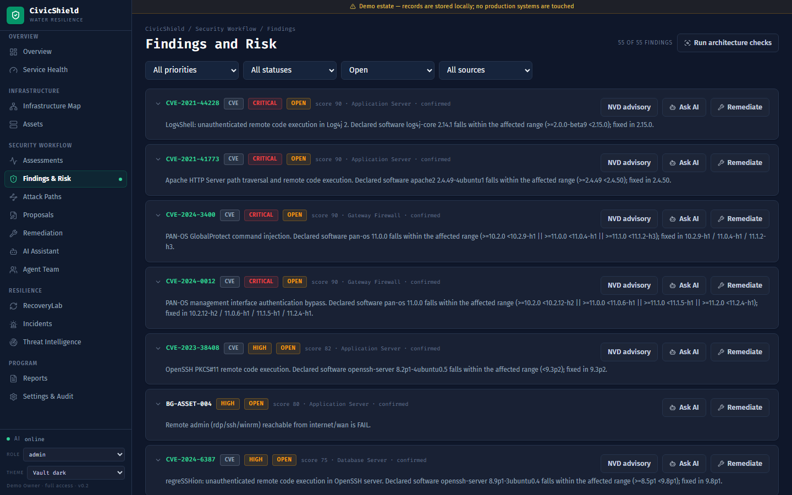

**Remediation** — pick a finding, Generate plan drafts a corrective action
with prerequisites, verification steps, rollback, and limitations; then
approve → simulate → verify, with every step in the audit log.

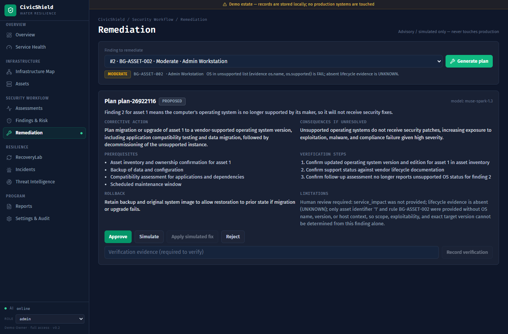

**Threat Intelligence** — bundled advisory catalog correlated with declared
asset software (confirmed / potential / unevaluated), feed-health with
controlled OSV sync, search and severity filters, and per-advisory detail
with vendor links and AI analysis grounded in internal matches.

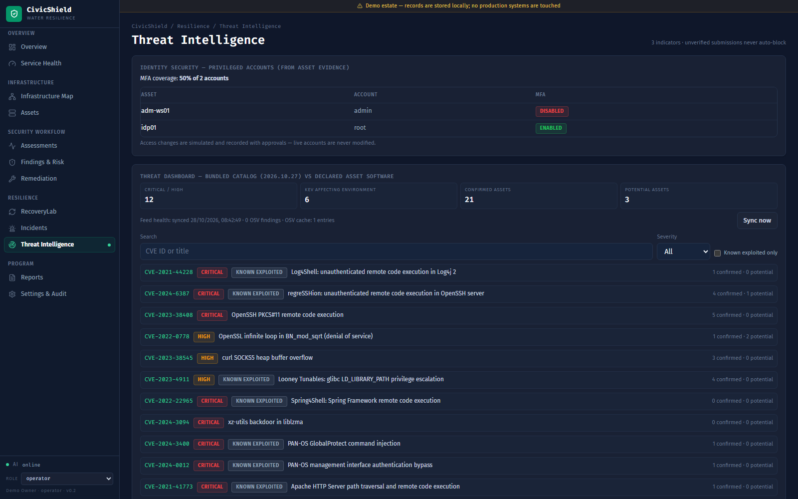

**Threat detail + AI analysis** — expand any advisory for CVSS, fixed
version, affected assets with match evidence, the rules-based recommended
action, and a live-model analysis stored to the Remediation queue.

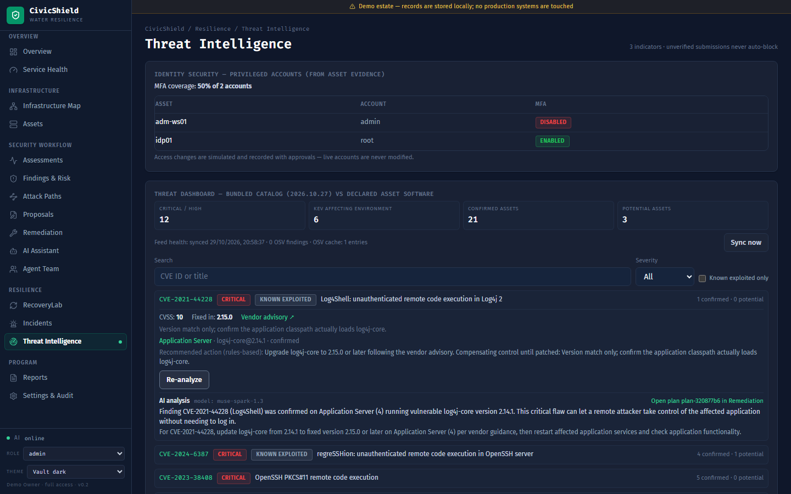

**RecoveryLab** — dependency-aware failure simulations with readiness,
restoration order, and per-run metrics; history survives refresh so
recommendations stay available on the latest run.

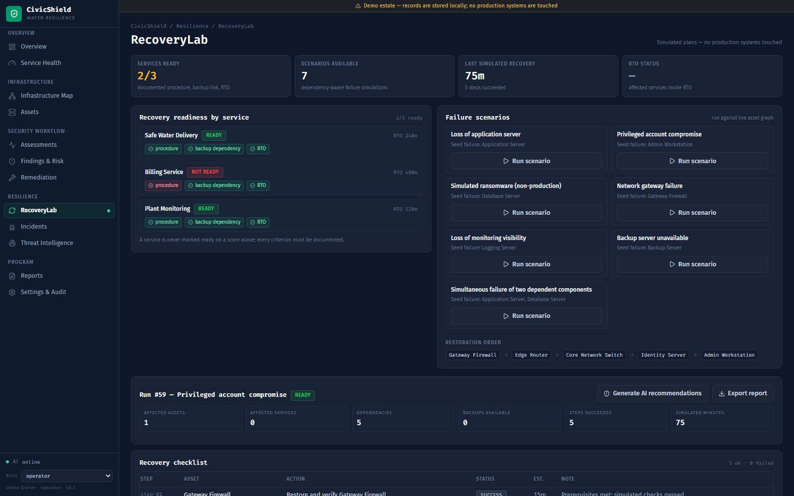

**Recovery AI recommendations** — one FixPilot plan per affected asset with
open findings (capped, honestly reported when findings are missing), each
reviewable on the Remediation page.

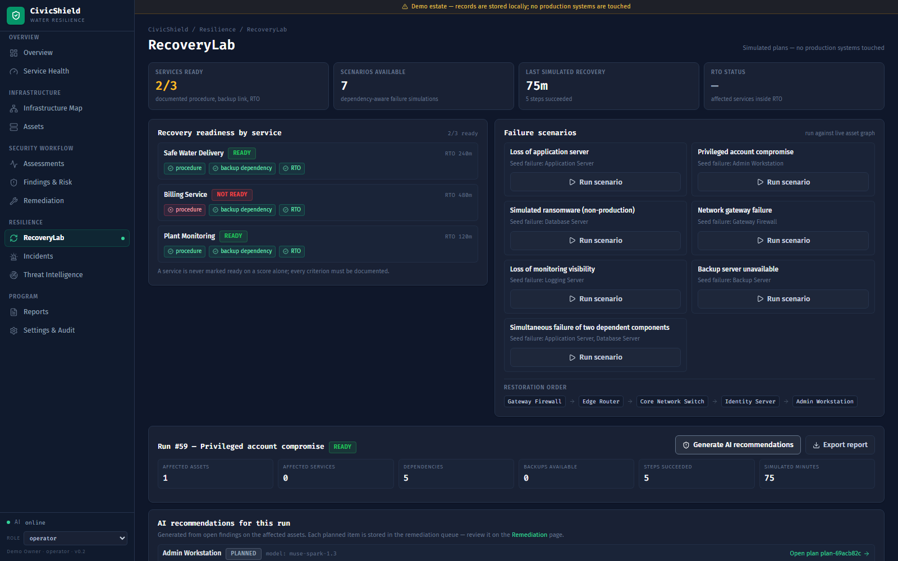

**Remediation tasks** — assign an owner, due date, and tracking note to any
plan; task changes are audit-logged without moving the lifecycle state.

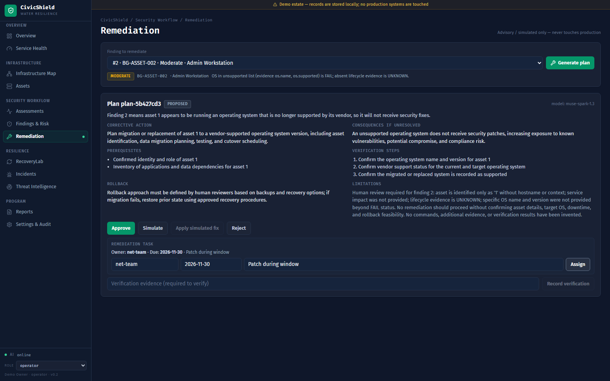

**Reports** — posture review plus JSON/CSV exports for posture,
assessments, recovery runs, threat exposure, and the audit log.

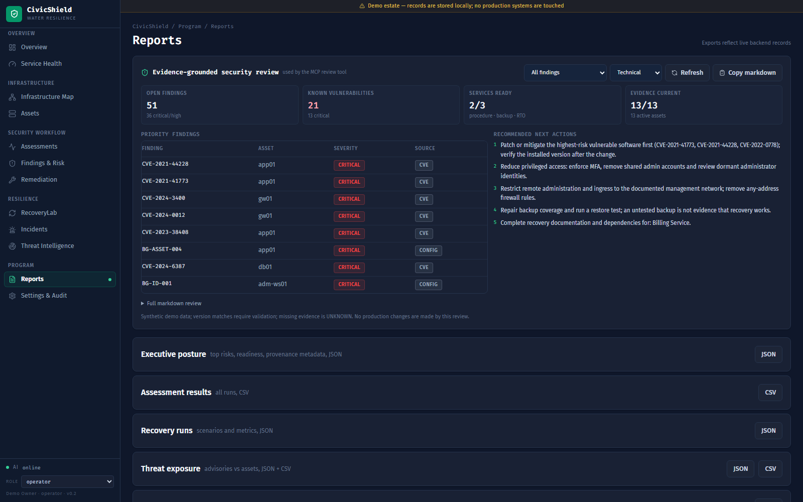

**Infrastructure Map** — dependency graph of the water utility (13 assets,
23 relationships) with asset-type coloring, critical-path highlighting,
and verified-link management.

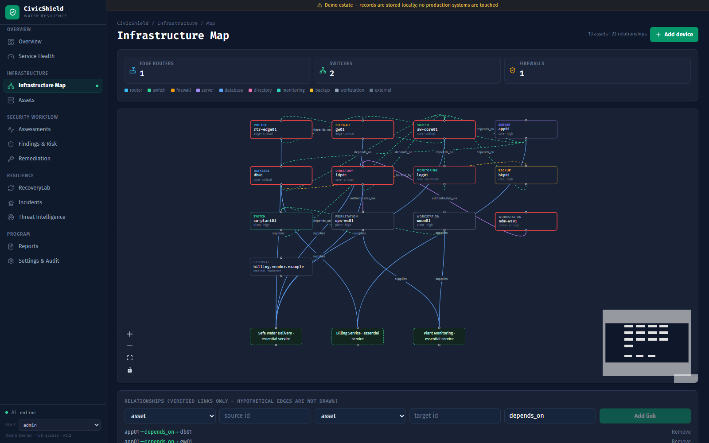

**Service Health** — executive lens with posture strip, affected-assets
intelligence map on live geography, priority queue, region/status/severity
table, and recovery objectives.

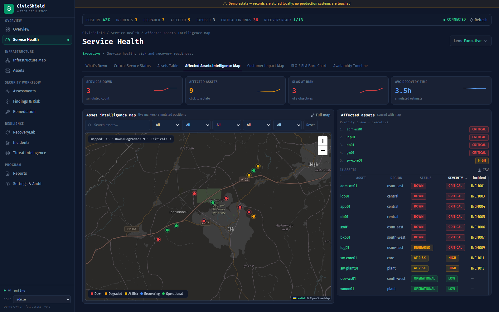

## Quickstart

Backend (FastAPI, SQLite demo DB):

```powershell
cd civicshield/backend
.\.venv\Scripts\python -m pip install -r requirements.txt
.\.venv\Scripts\python -m uvicorn app.main:app --host 127.0.0.1 --port 8000
```

Frontend (Vite dev server, proxies `/api` to port 8000):

```powershell
cd civicshield/frontend
npm install
npm run dev
```

Open http://localhost:5173/remediation in a browser.

## AI setup (Meta Muse Spark)

Copy `civicshield/backend/.env.example` to `civicshield/backend/.env` and set:

- `CIVICSHIELD_AI_PROVIDER=muse_spark`
- `META_API_KEY=` (your key — never commit this file)
- `META_API_BASE_URL=` and `META_MODEL_ID=` (from your Meta dashboard)

Check `GET /api/remediation/ai/status`: `"mode": "live"` means connected,
otherwise plans use the offline template. Details in
[civicshield/docs/AI_INTEGRATION.md](civicshield/docs/AI_INTEGRATION.md).

## Tests

```powershell
cd civicshield/backend
.\.venv\Scripts\python -m pytest tests/test_ai_mock.py tests/test_fixpilot.py -q
```

More docs: [civicshield/docs/](civicshield/docs/) (API, detection rules,
threat model, MCP server, demo script).
